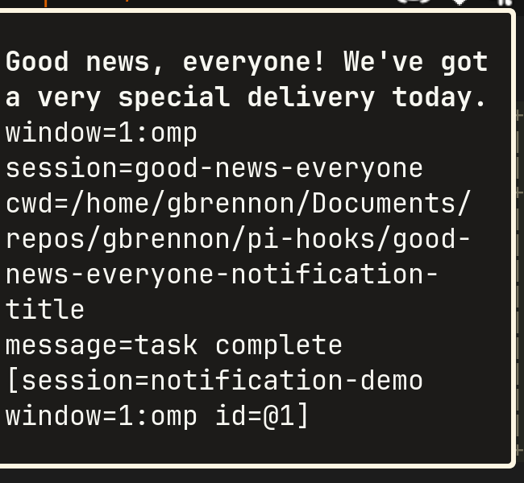
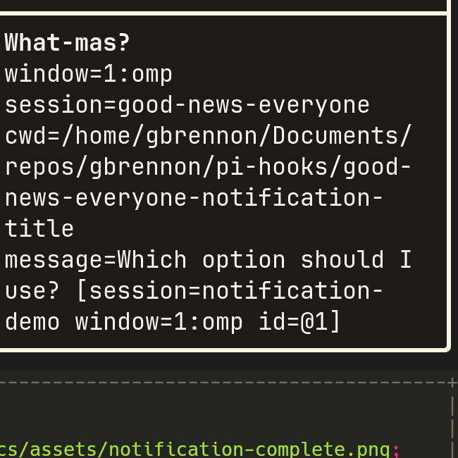
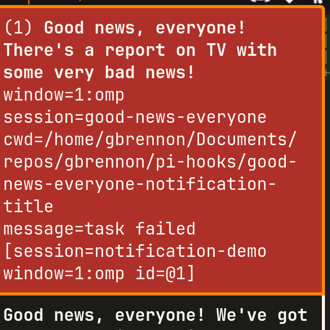

# Good News, Everyone!

Native TypeScript lifecycle notification hook for the Pi coding agent.
It announces your agent's state changes, both the good and the not-so-good.

## About the name

"Good news, everyone!" is Professor Farnsworth's signature catchphrase in Futurama.
He uses it to summon the Planet Express crew for a new mission.

The irony is that the news is almost never good.
The phrase usually precedes a disaster or an absurd errand,
so the crew learned to brace themselves whenever the Professor said "good news."

That is exactly what a notification hook does.

Farnsworth is the notifier of his world:
- he gathers the crew and delivers the message.

This hook gathers the agent's state changes and delivers them to you.

The name covers all three events, errors included:
- A question becomes "good news, everyone, your input is needed."
- A completion is genuine good news.
- A failure is still announced as "good news," which is the joke.

### Taglines

Runtime notifications pass the selected quote as the notification title via --title argument and the original message plus [tmux context] via --message argument.


- `question` notifications use quotes verified from Futurama Season 1, Season 2,
  and Season 3 transcripts.
- `complete` and `error` notifications use the same quote sources.
- Questions re-sent by reminders preserve the originally selected quote.

#### Screenshots







## Overview

- Dispatches notifications on `ui_prompt_start` (input needed) and
  `agent_settled` (complete/error) via `agent-notify`.
- Tracks the latest turn outcome per workspace directory.
- Re-sends unhandled `question` (input needed) notifications on a fixed interval until the user
responds, the session shuts down, or a reminder cap is reached.

## Re-notification

- A `question` notification is re-sent every
  `PI_NOTIFY_REMINDER_INTERVAL_MS` milliseconds (default `120000`).
- Reminders stop after `PI_NOTIFY_MAX_REMINDERS` re-sends (default `3`).
- Reminders are cancelled when a new agent turn starts (`agent_start`) or the
  session shuts down (`session_shutdown`).
- `complete` and `error` notifications are informational and never re-sent.

## Agent compatibility

- pi settles on `agent_settled` and signals idle input on `ui_prompt_start`.
- omp emits neither; it exposes `agent_end` as the terminal run signal, so the
  omp build drives complete, question, and error from `agent_end`.
- The install bakes `PI_HOOK_AGENT`, and the extension selects the lifecycle from
  it (`settled` for pi, `end` for omp).

## Architecture

- `src/contracts/` defines the `HookApi`, `Scheduler`, and event payload contracts.
- `src/notification_hook_service/` dispatches `question`, `complete`, and `error`
  notifications.
- `src/reminder_coordinator/` re-sends unhandled notifications on a bounded schedule.
- `src/system_scheduler.ts` adapts the runtime timer to the `Scheduler` port.
- `src/notification_hooks_extension/` registers lifecycle listeners on the Pi
  extension API.

## Verification

```bash
bun test
```
