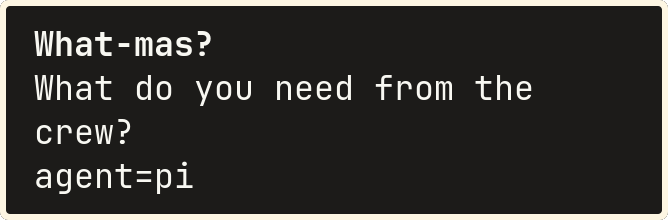
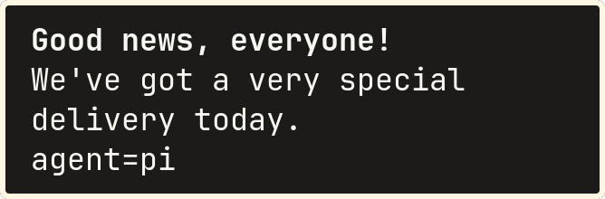
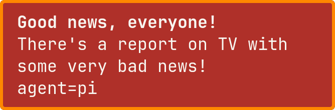

# Good News, Everyone!

Native TypeScript lifecycle notification hook for the Pi coding agent.
It announces your agent's state changes, both the good and the not-so-good.

> [!NOTE]
> If you are viewing this repository elsewhere, please be aware that it may be
> a read-only mirror. The original repository lives on Codeberg:
> <https://codeberg.org/gbrennon/good-news-everyone>.

## About the name

The project's name and its connection to the notification behavior are explained in
[`docs/name.md`](docs/name.md).

## Notification details

See [`docs/notifications.md`](docs/notifications.md) for taglines and reminder behavior.

### Screenshots

#### Question notification



Shown when the agent needs input before it can continue.

#### Completion notification



Shown when the agent completes its work successfully.

#### Error notification



Shown when the agent fails or is aborted.

## Installation

### Pi

Install the package with the Pi package manager:

```bash
pi install npm:@gbrennon/good-news-everyone@0.1.0
```

Pi loads `src/index.ts` from the package manifest.

### OMP

Install the package with the OMP plugin manager:

```bash
omp plugin install @gbrennon/good-news-everyone@0.1.0
```

OMP loads the dedicated `src/omp.ts` entrypoint, which uses the `agent_end`
lifecycle. Restart OMP after installing or updating the plugin.

### Manual installation

To install both hooks directly into the user extension directories:

```bash
./scripts/install.sh
```

## Overview

- Dispatches notifications on `ui_prompt_start` (input needed) and
  `agent_settled` (complete/error) via `notify-send`.
- Tracks the latest turn outcome per workspace directory.
- Re-sends unhandled `question` (input needed) notifications on a fixed interval until the user
responds, the session shuts down, or a reminder cap is reached.

## Architecture

See [`docs/architecture.md`](docs/architecture.md) for compatibility and component details.

## Automated releases

See [`docs/releases.md`](docs/releases.md) for the release process and required repository secrets.

## Verification

```bash
bun test
```
